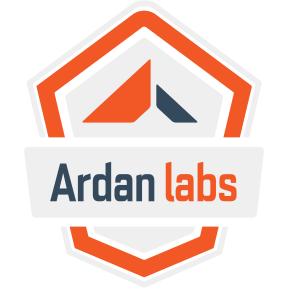

# IEEE-CARS 2026 — Foundational Rust for Secure Systems & Accelerating Python with Rust



> **Work in progress.** This is the live-teaching material for the IEEE-CARS 2026
> workshops. Sessions 1–3 — the manual, the numbered examples, the capstone, and
> the PyO3 project — are written and verified. The optional *Spares* chapters are
> still placeholders, and everything is subject to proof-reading before the event.

Live-teaching material for the IEEE-CARS 2026 workshops (Grand Forks, ND,
October 27, 2026). Three 2-hour sessions:

| Time | Session |
|------|---------|
| 10:15 – 12:15 | Session 1 — Core Rust, Ownership, Borrowing, Safe Error Handling, Cargo & Dependencies |
| 1:00 – 3:00 | Session 2 — Safe Parsing, Data Handling, Fearless Concurrency, Lifetimes & Smart Pointers |
| 3:15 – 5:15 | Session 3 — Accelerating Python with Rust: PyO3, Maturin, Project Structure & Packaging |

## Repository Layout

```text
code/
  Cargo.toml            # workspace; every exNN crate is a member
  ex01_movefail/ ...    # numbered examples, referenced from the manual
  capstone_starter/     # Capstone skeleton (TODOs) and capstone_solution/
  src/                  # root placeholder package
pyo3/
  ieee_cars_pyo3_demo/  # Session 3: maturin + PyO3 + Rayon (built with `maturin develop`)
manual/
  book.toml
  src/                  # the book source
  book/                 # generated by `mdbook build`, gitignored
```

> The Session 3 project deliberately lives outside the Cargo workspace — cargo
> workspaces and maturin builds don't play nicely together. Build it from its
> own directory with `maturin develop` (see the Session 3 chapters).

## Getting the Code

```bash
git clone https://github.com/thebracket/ieee-cars-2026.git
cd ieee-cars-2026
```

Prerequisites:

* **Rust** — install from <https://rustup.rs> (Sessions 1 and 2, and building the Session 3 extension).
* **Python 3.9+** with `venv` support — for Session 3.
* **mdbook** — only needed to view the manual (installation below).

## Running the Workbook Locally

The manual is an [mdBook](https://rust-lang.github.io/mdBook/):

```bash
cargo install mdbook
cd manual
mdbook serve --open
```

It is served at <http://localhost:3000> with live reload as you edit the source.
To build a static copy instead (written to `manual/book/`, which is gitignored):

```bash
mdbook build
```

> `manual/book/print.html` contains the entire book as a single printable page —
> handy if you want to skim everything at once.

## Running the Examples

All Session 1 and 2 examples are members of the `code/` workspace:

```bash
cd code
cargo run -p ex02_movearound      # run any example by name
cargo check -p ex20_eventlog      # or check just one
```

> `ex01_movefail` **intentionally fails to compile** — that's the lesson (the
> move-by-default error). Don't "fix" it.

The capstone:

```bash
cargo run -p capstone_starter     # skeleton with TODOs
cargo run -p capstone_solution    # the worked answer
```

The Session 3 extension builds separately (outside the workspace):

```bash
cd pyo3/ieee_cars_pyo3_demo
python3 -m venv .venv
source .venv/bin/activate          # Windows: .venv\Scripts\activate
pip install maturin
maturin develop                    # or --release for benchmarks
python wordstats.py --mb 16        # the benchmark demo
```

## Examples

| Example | Chapter | What it shows |
|---------|---------|---------------|
| [ex01_movefail](code/ex01_movefail) | [Why Doesn't this Work?](manual/src/ownership/move_by_default.md) | The move-by-default compile error---on purpose |
| [ex02_movearound](code/ex02_movearound) | [Move it Around](manual/src/ownership/move_it_around.md) | Passing ownership with move-and-return |
| [ex03_errors](code/ex03_errors) | [Safe Error Handling](manual/src/errors/intro.md) | Option, Result, `?`, and a `thiserror` enum (`--bin custom_error`) |
| [ex04_org](code/ex04_org) | [Project Structure and Visibility](manual/src/cargo/structure.md) | Inline, file-based, and directory modules; private-by-default |
| [ex05_data_race](code/ex05_data_race) | [Data-Race Protection](manual/src/concurrency/data_race.md) | The shared counter, fixed with atomics |
| [ex06_spawn_threads](code/ex06_spawn_threads) | [Spawning Threads](manual/src/concurrency/spawn_threads.md) | `thread::spawn`, `move` closures, returning values via `join` |
| [ex07_threads_divide](code/ex07_threads_divide) | [Dividing Workloads](manual/src/concurrency/threads_divide.md) | Chunking a workload across threads |
| [ex08_scoped_threads](code/ex08_scoped_threads) | [Scoped Threads](manual/src/concurrency/scoped_threads.md) | Borrowing in `thread::scope` |
| [ex09_rayon](code/ex09_rayon) | [Making it Easy with Rayon](manual/src/concurrency/rayon.md) | Parallel iterators and `par_iter` primes |
| [ex11_rust_atomic](code/ex11_rust_atomic) | [Rust Atomic](manual/src/concurrency/rust_atomic.md) | Fixing the race with `AtomicUsize` |
| [ex12_rust_mutex](code/ex12_rust_mutex) | [Rust Mutex](manual/src/concurrency/rust_mutex.md) | `Mutex` wraps its data---you can't forget to lock |
| [ex13_drop](code/ex13_drop) | [RAII and Drop](manual/src/lifetimes/raii.md) | `Drop` firing at function scope exit |
| [ex14_box](code/ex14_box) | [Smart Pointers](manual/src/lifetimes/smart_pointers.md) | Heap ownership with `Box` |
| [ex15_rc_arc](code/ex15_rc_arc) | [Smart Pointers](manual/src/lifetimes/smart_pointers.md) | Shared ownership with `Rc`; drops once |
| [ex16_borrow_checker](code/ex16_borrow_checker) | [RAII and Drop](manual/src/lifetimes/raii.md) | `Drop` observed across moves |
| [ex17_strings](code/ex17_strings) | [Rust's Many String Types](manual/src/parsing/strings.md) | UTF-8: bytes vs chars, safe slicing |
| [ex18_collections](code/ex18_collections) | [Collections and Bounds](manual/src/parsing/collections.md) | Arrays, Vec, HashMap; `.get()` returns `Option` |
| [ex19_iterators](code/ex19_iterators) | [Iterators](manual/src/parsing/iterators.md) | Chained map/filter/fold/zip |
| [ex20_eventlog](code/ex20_eventlog) | [Lab: The JSON Event Log](manual/src/parsing/lab.md) | Serde + thiserror: parse an event log, count alerts |
| [capstone_starter](code/capstone_starter) | [Capstone: The Traffic Report](manual/src/capstone/intro.md) | Starter skeleton with TODOs |
| [capstone_solution](code/capstone_solution) | [Walkthrough](manual/src/capstone/walkthrough.md) | The worked answer: JSON in, traffic report out |
| [pyo3/ieee_cars_pyo3_demo](pyo3/ieee_cars_pyo3_demo) | [The Word Stats Demo](manual/src/pyo3/wordstats.md) | PyO3 + Rayon word stats, GIL handling, wheel building |

## Contents

- [Welcome](manual/src/welcome.md)
- [Environment Check](manual/src/setup.md)
- **Session 1 — Core Rust, Ownership, Error Handling, Cargo**
  - [Ownership & Borrowing](manual/src/ownership/intro.md)
    - [Why Doesn't this Work?](manual/src/ownership/move_by_default.md)
    - [Move it Around](manual/src/ownership/move_it_around.md)
    - [Borrowing/References](manual/src/ownership/borrowing.md)
    - [Borrows in Rust](manual/src/ownership/borrowing2.md)
    - [Wrap Up](manual/src/ownership/wrap.md)
  - [Safe Error Handling](manual/src/errors/intro.md)
    - [It's Just Enums](manual/src/errors/enums.md)
    - [Option: No More Null](manual/src/errors/option.md)
    - [Result: Errors You Can't Ignore](manual/src/errors/result.md)
    - [Wrap Up: Custom Errors & Safe Math](manual/src/errors/wrap.md)
  - [Cargo and Dependencies](manual/src/cargo/intro.md)
    - [Project Structure and Visibility](manual/src/cargo/structure.md)
    - [Dependencies and the Supply Chain](manual/src/cargo/dependencies.md)
    - [Wrap Up: You Have a Cargo Project](manual/src/cargo/wrap.md)
- **Session 2 — Parsing, Concurrency, Lifetimes, Capstone**
  - [Safe Parsing and Data Handling](manual/src/parsing/strings.md)
    - [Collections and Bounds](manual/src/parsing/collections.md)
    - [Iterators: Owning and Borrowing](manual/src/parsing/iterators.md)
    - [Lab: The JSON Event Log](manual/src/parsing/lab.md)
  - [Fearless Concurrency](manual/src/concurrency/intro.md)
    - [Data-Race Protection](manual/src/concurrency/data_race.md)
    - [Spawning Threads](manual/src/concurrency/spawn_threads.md)
    - [Dividing Workloads](manual/src/concurrency/threads_divide.md)
    - [Scoped Threads](manual/src/concurrency/scoped_threads.md)
    - [C++ Atomic](manual/src/concurrency/cpp_atomic.md)
    - [Rust Atomic](manual/src/concurrency/rust_atomic.md)
    - [Spot The Difference - C++ Mutex](manual/src/concurrency/cpp_mutex.md)
    - [Rust Mutex](manual/src/concurrency/rust_mutex.md)
    - ["I Keep Hearing About Unsafe Rust..."](manual/src/concurrency/unsafe.md)
    - [Making it Easy with Rayon](manual/src/concurrency/rayon.md)
  - [Lifetimes and Smart Pointers](manual/src/lifetimes/intro.md)
    - [RAII and Drop](manual/src/lifetimes/raii.md)
    - [Smart Pointers: Box, Rc, Arc](manual/src/lifetimes/smart_pointers.md)
    - [Wrap Up](manual/src/lifetimes/wrap.md)
  - [Capstone: The Traffic Report](manual/src/capstone/intro.md)
    - [Walkthrough](manual/src/capstone/walkthrough.md)
- **Session 3 — Accelerating Python with Rust**
  - [PyO3 Intro](manual/src/pyo3/intro.md)
    - [Setup: venv, Maturin, and `maturin develop`](manual/src/pyo3/setup.md)
    - [Hello World, Called From Python](manual/src/pyo3/hello_world.md)
    - [PyResult: Errors Across the Fence](manual/src/pyo3/pyresult.md)
  - [The Word Stats Demo](manual/src/pyo3/wordstats.md)
  - [Maturin: Packaging and Wheels](manual/src/pyo3/packaging.md)
- **Spares — If Time Allows** *(placeholders, still being written)*
  - Clap CLI Lab
  - Packet Analyser Task
  - Data Accumulator Task
